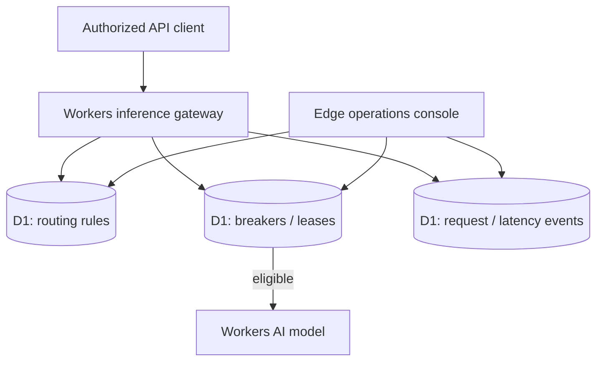

# KestrelMesh

**Inference edge control plane · reliability engineering**  
*Route requests predictably—even when models fail.*

[](https://github.com/amiddlebrook/KestrelMesh/actions/workflows/ci.yml) [](https://github.com/amiddlebrook/KestrelMesh/actions/workflows/deploy.yml) [](LICENSE) 

**[Launch live application](https://portfolio-kestrelmesh.averymiddlebrook2014.workers.dev)** · [Engineering architecture](docs/ARCHITECTURE.md) · [Security model](docs/SECURITY.md) · [Roadmap](docs/ROADMAP.md)

An edge inference gateway demonstration focused on **routing policy, failure isolation and recovery control**. KestrelMesh helps operators understand where requests go, what a provider failure means, and when a circuit should reopen.

> **Project status — portfolio engineering application.** The interfaces, D1-backed APIs, tests, and automatic deployment are functional. This is **not** a certified or audited enterprise product, and there are no claims of SSO, multi-tenant isolation, unbounded free usage, or uptime SLAs.

## What makes it different

- **Route preview.** Inspect routing decisions without invoking inference.
- **Circuit isolation.** Persist open / half-open / closed provider state in D1.
- **Guarded probes.** Atomic recovery leases limit concurrent half-open probes.
- **Request and latency evidence.** Store request history, timing summaries and circuit events.
- **Infrastructure UI.** Routing topology, telemetry and circuit operations console.

## System design



**Core stack:** Cloudflare Workers (TypeScript), Cloudflare D1 (SQLite), static Workers assets (vanilla JavaScript/CSS), optional Workers AI binding, GitHub Actions CI/CD. Workers AI inference is quota-bound and some workflows do not require AI at all.

**Critical domain path:** Request → route policy → circuit eligibility → supported model invocation → event / latency record → recovery policy.

A single-account Workers AI gateway is **not** a multi-provider global inference mesh. The app does not claim guaranteed latency, universal cost savings or cross-region failover without load testing.

## Explore the live product

Open **[KestrelMesh](https://portfolio-kestrelmesh.averymiddlebrook2014.workers.dev)**. Public visitors can inspect the branded, read-only product shell; actual database content and API operations require a credential. Each deployed application has **its own** D1 database, UI, API and release pipeline.

1. Load the labeled demonstration model catalog and routing rules.
2. Open the **Route Preview** to inspect the selected model without a real provider call.
3. Examine latency and request histories from actual recorded requests.
4. Inspect circuit-breaker state and guarded half-open recovery diagnostics.

The sample data is intentionally synthetic. UI counters reflect database records; screenshots, marketing claims and production-scale benchmarks are not fabricated.

## Run locally

**Requirements:** Node.js 22+, npm, and a Cloudflare account only if deploying. Git and Python 3.12 are useful for contributions; Python is required for this repository's Python tests when present.

```bash
git clone https://github.com/amiddlebrook/KestrelMesh.git
cd KestrelMesh
npm install
npm run check
npm test
npm run db:local
npm run dev
```

Open the local URL Wrangler prints. Local `localhost` development bypasses deployed bearer authentication so sample workflows are easy to exercise; **never treat that convenience as a deployment authentication configuration**. D1 migrations run locally before the first start.

For Cloudflare deployment, the production pipeline creates/reuses its own D1 database, applies migrations and updates the Worker. `wrangler.jsonc` contains a placeholder database ID that the pipeline resolves at runtime; do not commit your credentials or a machine-specific live database ID.

## API tour

`GET /api/health` is the only intentionally unauthenticated API route on the public deployment. All routes below require a bearer credential.

| Method | Endpoint | Purpose |
|---|---|---|
| `GET` | `/api/models` | Model catalog |
| `GET` | `/api/rules` | Routing policy |
| `POST` | `/api/route-preview` | Preview a route without inference |
| `GET` | `/api/metrics` | Recorded metrics |
| `GET` | `/api/circuits` | Circuit state |
| `GET` | `/api/circuit-leases` | Half-open recovery leases |

Example, using a root token already configured as the private Cloudflare `ADMIN_TOKEN`:

```bash
# Set this in your shell without checking it into source control:
export APP_ADMIN_TOKEN='YOUR_PRIVATE_TOKEN'
curl -sS 'https://portfolio-kestrelmesh.averymiddlebrook2014.workers.dev/api/overview' \
  -H "Authorization: Bearer $APP_ADMIN_TOKEN"
```

### Scoped API access (current milestone)

The root administrator can mint time-limited **viewer** or **operator** credentials from **Access control**, or with `POST /api/access/keys` (admin only). The response returns the new secret **exactly once**. Only its SHA-256 digest is stored in D1.

```json
{
  "label": "Portfolio read-only integration",
  "role": "viewer",
  "route_prefix": "/api/",
  "expires_in_days": 7
}
```

- `viewer`: `GET` / `HEAD`; cannot mutate state.
- `operator`: permitted methods excluding `DELETE`; can be restricted to an API prefix.
- `admin`: the root Worker secret, not a stored database key; only it can issue/revoke keys or inspect credential audit.
- Scoped credentials expire after 1–90 days, can be revoked immediately, and record last use. Endpoint permissions apply to API calls; **they are not tenant isolation or an SSO/RBAC system**.

Keep credentials in a secret manager. Do **not** include them in URLs, source code, issues, screenshots, or documentation. Browser credentials in this demo use tab-lifetime `sessionStorage` and should be considered sensitive.

## Delivery and verification

The two workflows under `.github/workflows/` are separate:

1. **`ci.yml`** checks TypeScript, browser JavaScript, SQL-backed integration tests, and security contracts on pull requests / pushes.
2. **`deploy.yml`** runs checks on `main`, resolves and migrates the correct D1 instance, deploys static assets + Worker, installs `ADMIN_TOKEN` via Wrangler secret storage, and smoke-tests live authenticated/unauthenticated APIs.

Required GitHub Actions secrets: `CLOUDFLARE_ACCOUNT_ID`, `CLOUDFLARE_API_TOKEN`, and `APP_ADMIN_TOKEN`. The Cloudflare token requires permissions to edit Workers and D1 on the target account. See [Security](docs/SECURITY.md) for credential lifecycle and limitations.

Useful commands:

```bash
npm run check       # TypeScript + frontend syntax
npm test            # Application and security tests; Python tests when present
npm run db:local    # Apply local D1 migrations
npm run verify:live # Requires DEPLOY_URL and APP_ADMIN_TOKEN environment variables
```

GitHub workflow badges show the latest GitHub Actions status, **not** independent penetration testing or SLO certification. Free-tier quotas and provider availability apply. Deployment does not automatically upgrade billing.

## Security and known limitations

Implemented: deployment-time root secret, scoped expiring API keys, revocation/audit, parameterized SQLite access, defensive input checks, and fail-closed authorization for protected routes. The root credential and all data exist within **one account workspace**.

**Not yet implemented:** Provider-neutral adapters, weighted scheduling, global quotas, request deadlines, OpenTelemetry, measured p95/p99 SLOs and chaos / sustained-load qualification.

The published [production-readiness backlog](docs/ROADMAP.md) tracks the remaining work; read [SECURITY.md](docs/SECURITY.md) for a candid threat model. CI coverage is meaningful engineering evidence, but this project should not be presented as SOC 2 certified, penetration-tested, or production-ready for sensitive multi-customer data.

## Development contributions

Issue reports, reproducible failure cases, test fixtures and targeted pull requests are welcome. Prefer changes that include tests for concurrency, authorization, unexpected input, and migration safety. Keep mock inference clearly labeled, never commit tokens or real customer datasets, and document important tradeoffs in `docs/ARCHITECTURE.md`.

**License:** [MIT](LICENSE).

## Distinct application interface

This repository uses its own workspace layout and record presentation, not the standard UI shell from the other portfolio apps. See [the design-system specification](docs/DESIGN_SYSTEM.md) for the interaction model, security/privacy considerations, and remaining verification work.
